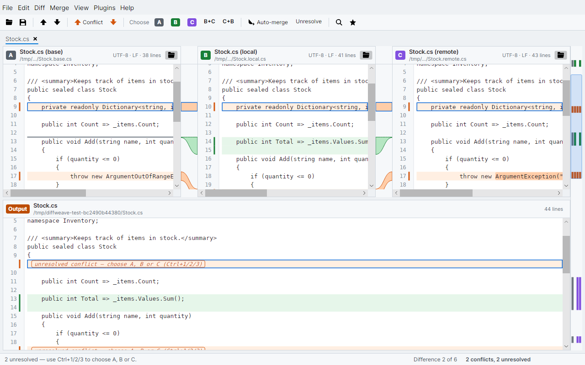
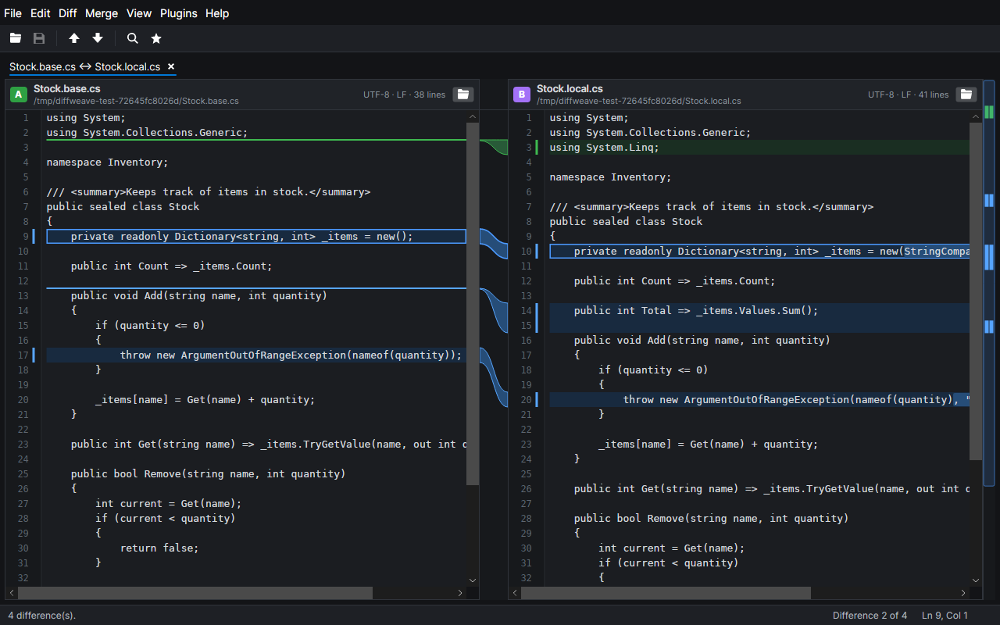
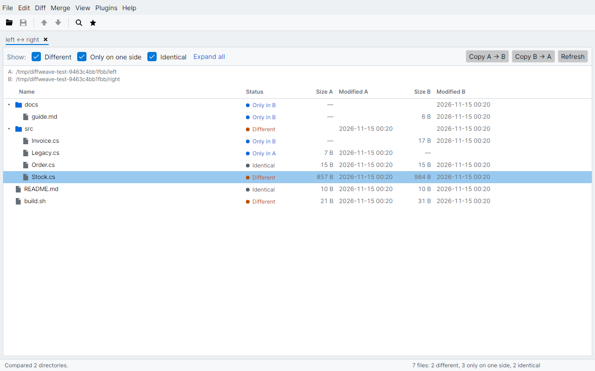
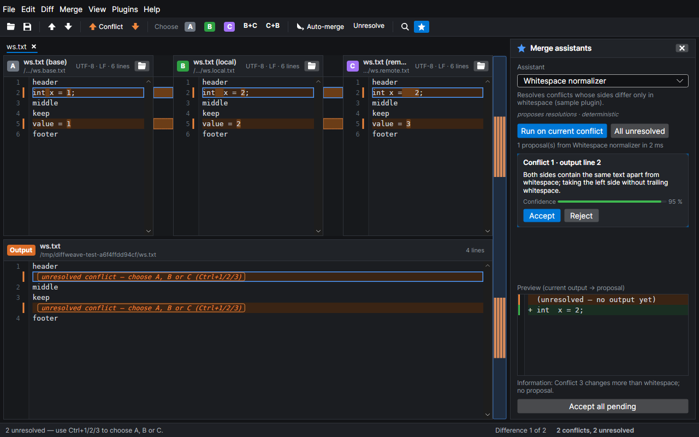

# DiffWeave

DiffWeave is a cross-platform graphical diff and three-way merge tool in the spirit of KDiff3, written in C# on
.NET 11 with Avalonia 12. It compares two or three files or directories, merges files with an editable output pane,
and works as `git difftool` / `git mergetool`. Its editor is built to be extended by plugins.



## Features

* **File comparison** of two (A | B) or three (A = base | B | C) files side by side, with line and word-level
  highlighting, curved connecting bands between panes, an overview ruler of all differences, line numbers and
  synchronized scrolling.
* **Three-way merge** with an editable OUTPUT pane: automatic merge of non-conflicting changes, per-conflict choice of
  A, B or C (also B+C and C+B), unresolve, conflict navigation, free editing with cut/copy/paste and a single
  undo/redo history for edits and choices. Status bar: *N conflicts, M unresolved*.
* **Directory comparison** of two or three folders: tree with status, size and modification time per side, filters
  (different / only on one side / identical), open a file pair with double click or Enter, copy A → B / B → A with
  confirmation.
* Ignore options that re-diff live: whitespace (trailing / amount / all), case, blank lines.
* Encoding (UTF-8/16/32 with or without BOM, Latin-1) and line-ending detection; saving preserves them.
* Find (Ctrl+F, F3, case, regex, whole word), go to line (Ctrl+G), word wrap, visible whitespace, tab size, font
  family and size, light and dark themes and a colour-blind safe palette.
* Reload prompt when files change on disk, unsaved-changes guard, recent comparisons, settings in the XDG config
  directory.
* Virtualized rendering: files with 200 000 lines open and scroll smoothly.
* Plugins: commands, editor decorations, merge lifecycle hooks and *merge assistants* that propose conflict
  resolutions which the user previews and accepts or rejects (all accepted proposals are undoable).

| Two-way diff (dark) | Directory comparison | Merge assistants panel |
| --- | --- | --- |
|  |  |  |

## Build and run

Requires the .NET 11 SDK (see `global.json`).

```sh
dotnet build DiffWeave.slnx                 # warnings are errors
dotnet test DiffWeave.slnx                  # Core, App (headless UI) and sample plugin tests
dotnet run --project src/DiffWeave.App -- a.txt b.txt
```

The executable is `artifacts/bin/DiffWeave.App/debug/diffweave`. For a self-contained build:

```sh
dotnet publish src/DiffWeave.App -c Release -r linux-x64 --self-contained -o out/diffweave
```

On Linux, `packaging/diffweave.desktop` and `packaging/diffweave.png` (also `diffweave.svg`) provide a desktop entry
and icon, e.g. copy them to `~/.local/share/applications/` and `~/.local/share/icons/hicolor/256x256/apps/`.

The UI tests save screenshots (light and dark) of the main screens under
`artifacts/bin/DiffWeave.App.Tests/debug/screenshots/`.

## Command line

KDiff3-compatible:

```
diffweave FILE_A FILE_B [FILE_C]             compare files (one file: compare with an empty pane)
diffweave DIR_A DIR_B [DIR_C]                compare directories
diffweave -m BASE LOCAL REMOTE -o OUTPUT     merge
diffweave -b BASE LOCAL REMOTE -o OUTPUT     same, base given with -b
  --L1/--L2/--L3 LABEL, --fname LABEL       pane labels
  --auto                                    merge without UI when nothing remains unresolved
  --qall                                    quiet: with --auto never open the window
  -h/--help, --version
```

Exit codes: `0` merge resolved and saved (or comparison closed), `1` cancelled / unresolved / not saved,
`2` invalid command line.

## git integration

```sh
git config --global merge.tool diffweave
git config --global mergetool.diffweave.cmd \
  'diffweave --auto --L1 "$MERGED (Base)" --L2 "$MERGED (Local)" --L3 "$MERGED (Remote)" -o "$MERGED" "$BASE" "$LOCAL" "$REMOTE"'
git config --global mergetool.diffweave.trustExitCode true
git config --global diff.tool diffweave
git config --global difftool.diffweave.cmd 'diffweave --L1 "$LOCAL" --L2 "$REMOTE" "$LOCAL" "$REMOTE"'
```

See [docs/git-integration.md](docs/git-integration.md) for a `git mergetool` walkthrough and keyboard shortcuts.

## Keyboard

| Keys | Action |
| --- | --- |
| Ctrl+Up / Ctrl+Down | previous / next difference |
| Ctrl+PgUp / Ctrl+PgDn | previous / next unresolved conflict |
| Ctrl+1 / Ctrl+2 / Ctrl+3 (or A / B / C outside the output pane) | choose A / B / C for the current region |
| Ctrl+Shift+M | auto-merge all |
| Ctrl+S, Ctrl+Shift+S | save, save as |
| Ctrl+Z / Ctrl+Y | undo / redo |
| Ctrl+F, F3, Shift+F3, Ctrl+G | find, next, previous, go to line |
| Ctrl+Plus / Ctrl+Minus / Ctrl+0 | font size |

## Project layout

| Path | Content |
| --- | --- |
| `src/DiffWeave.Extensibility` | Public, versioned extension API (no dependencies). |
| `src/DiffWeave.Core` | Text model, diff and alignment algorithms, merge engine, directory comparison, plugin manager. UI-free. |
| `src/DiffWeave.App` | The Avalonia application (`diffweave`). |
| `samples/` | A deterministic sample plugin (whitespace-normalizing merge assistant). |
| `tests/` | Core and headless UI tests. |
| `docs/` | [Architecture](docs/architecture.md), [UI](docs/ui.md), [extensibility](docs/extensibility.md), [git integration](docs/git-integration.md), [future assistant use-cases](docs/ai-extension-points.md). |

## Writing plugins

Plugins are folders with a `plugin.json` manifest and an assembly implementing `IDiffWeavePlugin`, loaded in an
isolated `AssemblyLoadContext` from `~/.config/diffweave/plugins/` (XDG aware) or `<appdir>/plugins/`. They can
contribute menu commands, editor decorations, merge lifecycle hooks and merge assistants. Start with
[docs/extensibility.md](docs/extensibility.md) and the sample in `samples/DiffWeave.Samples.WhitespacePlugin`;
[docs/ui.md](docs/ui.md) explains where each extension point appears in the UI.
